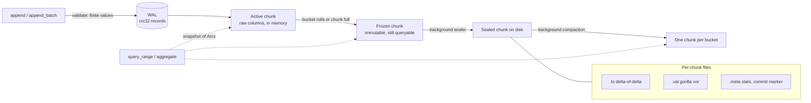

# columnar-tsdb

[](https://github.com/monaaoua9/columnar-tsdb/actions/workflows/ci.yml)


An embedded, zero-dependency time-series storage engine in Rust. Gorilla-style
compression, immutable columnar chunks, a write-ahead log, a time-bucket index
that answers aggregates from chunk metadata, and a background thread that seals
and compacts chunks while reads and writes keep going.

Why it is built this way: [docs/DESIGN.md](docs/DESIGN.md).

```rust
use columnar_tsdb::{Config, Engine, Selector, SeriesKey};

let engine = Engine::open(Config::new("./data"))?;
let cpu = SeriesKey::new("cpu_usage").label("host", "web-1");

engine.append(&cpu, 1_700_000_000_000, 41.5)?;
let pts = engine.query_range(&cpu, 1_700_000_000_000, 1_700_003_600_000)?; // [start, end)
let agg = engine.aggregate(&cpu, i64::MIN, i64::MAX)?;                      // count/sum/min/max/avg

// across series: cpu_usage{dc="fra", host!="web-9"}, grouped by host
let sel = Selector::new("cpu_usage").eq("dc", "fra").ne("host", "web-9");
let per_host = engine.aggregate_by(&sel, "host", i64::MIN, i64::MAX)?;
```

## Try it in five minutes

No library code needed; the `tsdb` binary wraps the same engine.

```
cargo build --release --bin tsdb          # target/release/tsdb

# cpu.lp, four lines of line protocol:
#   cpu_usage,host=web-1,dc=fra value=41.5 1700000000000
#   cpu_usage,host=web-1,dc=fra value=43.0 1700000010000
#   cpu_usage,host=web-2,dc=ams value=12.5 1700000000000
#   cpu_usage,host=web-2,dc=ams value=15.0 1700000010000

tsdb import ./data cpu.lp                  # imported 4 points
tsdb series ./data                         # cpu_usage{dc=fra,host=web-1} ...

# without --step a query is "the value at --end"; with --step it is a range
tsdb query ./data 'cpu_usage{dc="fra"}' --start 1700000000000 --end 1700000020000
tsdb query ./data 'avg by (dc) (cpu_usage)' --start 1700000000000 --end 1700000020000 --step 10s
tsdb query ./data 'rate(cpu_usage{host="web-1"}[30s])' --start 1700000000000 --end 1700000020000

# deleting needs an explicit range, on purpose
tsdb delete ./data 'cpu_usage{host="web-2"}' --start 1700000000000 --end 1700000005000

tsdb serve ./data 127.0.0.1:8086 --token s3cret    # then, from another terminal:
curl -H 'Authorization: Bearer s3cret' 'http://127.0.0.1:8086/query?query=cpu_usage&start=now-1h&end=now&step=1m'
```

Timestamps are integers in whatever unit you write (the examples use milliseconds);
`now` and `now-5m` only make sense when you write milliseconds.

## Data flow



A point is durable (in the OS sense, see `SyncMode`) once `append` returns. It
sits in an active chunk until its time bucket changes or the chunk reaches
`max_points_per_chunk`; then the chunk is frozen (swapped for a fresh one under
the series lock, no IO) and the maintenance thread encodes it into three files.
A checkpoint (`flush`, close, or WAL over `wal_max_bytes`) truncates the WAL
once every in-memory chunk is sealed.

## Layout

```
src/
  bitio.rs            msb-first BitWriter / BitReader
  compress/
    timestamp.rs      delta-of-delta codec
    gorilla.rs        xor float codec
  chunk.rs            ActiveChunk, SealedChunk, file framing, recovery scan
  series.rs           per-series state: active / frozen / sealed + snapshots
  index.rs            inverted label index (name / label=value -> sorted series ids)
  wal.rs, catalog.rs  write-ahead log (sharded), series catalog (both crc'd, torn-tail safe)
  bin/crash_writer.rs helper process for the hard-kill test
  engine.rs           public API, background worker, flush, compaction, retention
  funcs.rs            rate / increase / quantile / stddev / moving averages over points
  sketch.rs           DDSketch, mergeable quantile estimates with a relative error bound
  lineproto.rs        influx-style line protocol parser + bulk ingest
  query/              PromQL-flavoured language: lexer + parser (parse.rs), evaluator (eval.rs)
  rollup.rs           incremental downsampling into ordinary series
  snapshot.rs         restore + helpers for Engine::snapshot (hard-linked online copy)
  metrics.rs          counters + prometheus text
  server.rs, json.rs  std-only http front end
  bin/tsdb.rs         command line tool
tests/engine.rs       end-to-end: recovery, compaction, late writes, labels, concurrency,
                      randomized comparison against a BTreeMap model
tests/crash.rs        kills a writer process mid-flight, reopens, verifies
tests/query.rs, http.rs, cli.rs, snapshot.rs, rollup.rs, delete.rs, props.rs   one per feature; props and delete are randomized
examples/             ingest_bench.rs, concurrent_bench.rs
```

On disk:

```
data/
  LOCK  series.cat  wal.log
  chunks/
    {series:016x}-{id:010}.ts     timestamps, own file
    {series:016x}-{id:010}.val    values, own file
    {series:016x}-{id:010}.meta   count/min/max/sum/min_ts/max_ts, written last
```

Labels live in the series catalog (dictionary encoded: one id per label set),
not repeated per point.

## Compression

- **Timestamps**: delta-of-delta with 1/9/12/16-bit prefix buckets and a 68-bit
  escape. A fixed scrape interval costs one bit per point.
- **Values**: XOR with the previous value; reuse the previous leading/trailing
  zero window when it fits, otherwise emit a new 5+6 bit window header.
- Both are exact for any `i64` / finite `f64` sequence (tested against random
  and adversarial inputs). Values are rejected if NaN or infinite.

## Query path

`aggregate(start, end)` finds candidate buckets with a `BTreeMap` range lookup
(`O(log B)`; the bucket of a timestamp itself is `O(1)` arithmetic). Chunks whose
`[min_ts, max_ts]` lies fully inside the range contribute their stored
`count/sum/min/max` and are never read from disk. Only chunks straddling the
range edges are decoded. `query_range` decodes the timestamp column first, binary
searches the slice, then decodes values only up to the end of the slice.

## Label queries

`Selector::new(name).eq(k, v).ne(k, v)` picks series. The engine keeps an inverted
index: metric name -> sorted series ids, and `(label, value)` -> sorted series ids.
`eq` intersects posting lists, `ne` subtracts them (a series without the label
passes `ne`), so resolving a selector never scans the catalog.

- `select` returns the matching keys.
- `query_select` returns raw points per series.
- `aggregate_select` merges per-series aggregates; each series still uses the
  stats-only path for chunks fully inside the range.
- `aggregate_by(sel, "dc", ..)` is a GROUP BY label (series lacking the label are
  grouped under `""`).

`like(label, "web-*")` is a glob matcher (`*` any run, `?` one character) that walks
only the distinct values of that label. `re(label, "web-(1|2)")` / `not_re` take a regex
from the crate's own engine (`regex.rs`): whole-value match, classes, groups, `|`, `* + ?
{n,m}`, `\d \w \s`; no backreferences or lookaround. It is an NFA simulation, so matching
is linear in the input and a hostile pattern can't blow up. A pattern that doesn't compile
selects nothing (the query language rejects it at parse time).

The index is memory-only and rebuilt from the series catalog on open.

### Downsampling

`aggregate_windows(key, start, end, step)` (and `aggregate_windows_select` across
series) returns one aggregate per `step`-wide window, aligned to `start`, empty
windows omitted. Windows are clamped to the span the series actually holds, so
`i64::MIN..i64::MAX` is fine, and any window that covers whole chunks is answered from
their stats.

## Query language

`query::run(&engine, text, &Ctx)` evaluates a small PromQL-like language. Durations are in
ms (`5m` = 300000), so timestamps are assumed to be ms.

```
cpu{dc="fra", host!="web-9", rack=~"r-(1|2)"}  last value per series (=~ regex, !~ negated, =* glob)
rate(reqs[1m])                                 per-second counter rate, resets handled
avg_over_time(cpu[5m])                         sum/min/max/count/first/last/stddev/stdvar too
quantile_over_time(0.99, latency[5m])          p50 p90 p95 p99 shortcuts exist as well
sum(rate(reqs[1m])) by (host)                  across-series sum/avg/min/max/count
topk(5, max_over_time(cpu[1h]))                bottomk too
rate(reqs[1m]) * 60 > 100                      scalar arithmetic; comparisons filter
load - load offset 1h                          compare with the past (offset also goes inside: rate(x[5m] offset 1d))
sum(rate(a[1m])) by (host) / sum(b) by (host)  vector ops match on identical labels
```

`Ctx::instant(start, end)` gives one point per series (at `end`); `Ctx::stepped(start, end,
step)` gives one per window. Without a `[range]` a stepped query uses tumbling windows; with
one, each step looks back that far. At most 100k steps per query. Parse errors carry the
character offset.

`funcs` has the same reductions as plain functions over `&[Point]`. `sketch::Sketch` is a
DDSketch (you pick alpha, 0.01 = 1% relative error): constant memory, merge across chunks or hosts, and
`to_bytes` / `from_bytes` to store it.

## Ingest, server, CLI

Line protocol, one f64 per line, `\` escapes for `, = space` in names:

```
cpu_usage,host=web-1,dc=fra value=41.5 1700000000000
cpu_usage,host=web-1 41.5            # no timestamp: caller's default (now over http)
```

Fields: `value=41.5` (or a bare number) keeps the metric name; any other field name is appended
with `_`, and several fields on one line become several series:

```
cpu,host=web-1 usage=41.5,idle=58.5 1700000000000     -> cpu_usage{host=web-1}, cpu_idle{host=web-1}
```

Numbers may carry influx's `i` / `u` suffix, `t` / `f` / `true` / `false` store 1 / 0, string
fields are an error. (Before this, the field name was ignored and `usage=` wrote to `cpu`.)

`lineproto::ingest(&engine, text, default_ts)` parses everything first (a bad line writes
nothing, the error names the line) and appends one batch per series.

`server::Server::start(engine, "127.0.0.1:8086")` is a plain `std::net` HTTP/1.1 server,
thread per connection, 64 connections max, 8 MiB body max, no TLS and no keep-alive. Put a
proxy in front of it if it is reachable from anywhere but localhost.

```
GET  /health
GET  /metrics                                         prometheus text
POST /write[?ts=now-5m]                               line protocol body -> 204
POST /delete?match=cpu{host="a"}&start=T&end=T          delete [start, end); all three required
GET  /query?query=...&start=now-1h&end=now&step=30s   -> {"data":{..},"meta":{..}}
```

Errors come back as `{"error":{"code":"BAD_QUERY","message":"..."}}`. With a token configured every route except `/health` answers 401 without `Authorization: Bearer <token>`.

`cargo run --bin tsdb -- <command> <dir>`: `import`, `export`, `query`, `series`, `stats`,
`compact`, `snapshot`, `delete` (needs `--start` and `--end`), `serve`.

## Snapshots, rollups, metrics

`engine.snapshot(dest)` copies a live database into an empty directory. Sealed chunks are
hard-linked (they never change after their tmp+rename), the WAL and catalog are copied under
their locks, WAL first so every series a copied record names is in the copied catalog.
Writers keep going; no flush is forced, opening the copy replays the WAL. While it runs the
maintenance thread waits (chunk set must not change). `snapshot::restore(src, dst)` makes an
independent real copy; it refuses a directory that has a `LOCK` file (a live one).

`rollup::Rollup::new(selector, step).run(&engine, upto)` writes `name:5m:avg`, `:min`,
`:max`, `:sum`, `:count` series (same labels) for every complete window before `upto`. It
resumes from the newest rolled window, recomputes that one every run (so late points land and
re-running is harmless), and the results are ordinary series: query them, keep them past
`retention`.

`engine.metrics()` returns counters (appends, late points, chunks sealed, merges,
compactions, expired chunks, queries, maintenance errors, ...); `render_metrics()` adds the
`stats()` gauges in prometheus text format.

## Concurrency model

- One `RwLock` per series; writers to different series don't contend except for
  the WAL mutex.
- Queries copy a few `Arc`s and filtered in-memory points under a read lock, then
  decode with no lock held. Sealed chunks are immutable.
- Freeze -> seal is a single write-lock swap, so a reader sees every point exactly
  once (checked by the concurrency test: readers assert gap-free prefixes while
  sealing and compaction run).
- Compaction writes the merged chunk first, then swaps it in; old files are
  deleted when the last `Arc` to them drops, so running queries never lose files.
- Lock order: `maintenance -> catalog -> series -> wal`. Writers hold at most one
  series lock, the checkpoint takes series locks in id order.

## Out-of-order writes

Any timestamp order is accepted, including inside one batch.

- A point with `ts > newest ts of the series` takes the fast path (active chunk).
- Anything else is a *late write*: it goes into a small sorted buffer per series
  and is visible to queries immediately. Same `ts` again means **last write wins**,
  also over a value that is already sealed on disk.
- The maintenance thread folds the buffer into the sealed chunk(s) of the point's
  bucket: decode, merge with override, write one new chunk, swap it in under the
  series lock, delete the old files when the last reader lets go. Points at or above
  the oldest raw in-memory chunk wait until that chunk is sealed, so sealed chunks
  never overlap unsealed data.
- A chunk with a late point inside its `[min_ts, max_ts]` is not answered from
  stats; it is decoded and merged. Everything else keeps the stats-only path.
- WAL records carry a `late` flag. Replay skips in-order records that are already
  sealed, but re-applies every late record: that is idempotent and the log replays
  in write order, so the final value per `ts` is the same as before the crash.
- With `retention` set, a late point older than `newest - retention` is rejected
  with `Error::TooOld` instead of being stored and expired right away.

The price is write amplification: merging one late point rewrites its bucket.
Batching in the buffer (`max_ooo_points`, maintenance interval) is what keeps that
tolerable. Correctness is checked by a randomized test that mixes in-order, late
and duplicate writes with flushes, compactions and crash-style reopens against a
`BTreeMap` model.

## Deletes

`delete_range(&key, start, end)` removes the points in `[start, end)` and returns how many
went; `delete_select` does it for every series a selector matches. The series stays in the
catalog (empty). Durable once the call returns.

How it stays correct across crashes:

- The delete is logged in the WAL as two records written together (range, then a *mark*:
  the chunk id counter at that moment). Replay only sees it if both halves made it.
- Sealed chunks overlapping the range are rewritten without those points (new chunk, old one
  swapped out under the series lock), raw in-memory chunks and the late buffer are cut, and
  the active chunk is frozen so later writes get chunk ids above the mark.
- Replay applies a delete to memory (everything there was written before it) and to sealed
  chunks with an id below the mark, nothing else. Without the mark a point written *after* a
  delete, inside its range, and sealed before the crash would be deleted again by the replay
  (a randomized test found exactly that).
- The WAL is not truncated while any chunk file a delete replaced still exists (a running
  query can keep it alive). Otherwise a crash could bring back the old file with no delete
  record left to remove its points again.
- The mark also bumps the id counter on open, so ids handed out after a restart stay above
  every mark still in the log.

For one series a delete is all or nothing after a restart: before its WAL record is durable
nothing is visible, afterwards replay finishes whatever the crash interrupted. What is *not*
atomic is `delete_select` over several series: each series gets its own record, so a crash
in the middle can leave some series deleted and others not (the call never returned, so
nothing was promised; run it again). Concurrent queries see all of one series' delete or none
of it. Old binaries must not open a WAL that holds delete records.

## Recovery

On open: catalog and chunk metas are loaded, orphan/tmp files removed, chunks
fully contained in a larger chunk of the same series (crash during compaction)
are dropped, then the WAL is replayed (in-order records newer than the last sealed ts, plus all late records).
Torn WAL/catalog tails are cut at the first bad checksum.

This is tested with real crashes, not simulated ones: `tests/crash.rs` runs the writer
as a separate process (a deterministic stream of in-order points plus late overwrites,
with sealing, merging, checkpoints and compaction constantly in flight), kills it with
`TerminateProcess` / `SIGKILL` at ten different moments on the same directory, reopens
it in a second process after each kill and checks that every acknowledged point is
present, values are exactly those of the model, and nothing else appeared.

## Numbers

A more recent three-run set is in [docs/BENCHMARKS.md](docs/BENCHMARKS.md). Its read rows (1 h window, full scan) are far slower than the ones below because of how this laptop reads freshly written files; the doc explains.

`cargo run --release --example ingest_bench` (8 series x 500k points, 10 s
interval, 1-day buckets, noisy 2-decimal gauge, laptop, Windows 11). The ingest
figure is sustained: writers are throttled by the sealer (`max_frozen_chunks`), so
it includes the cost of writing the chunk files, not just the in-memory append.

```
ingest: 4000000 points in 1.03s = 3.87 M pts/s
stored: 472 chunks, 6.14 bytes/point (2.6x vs 16 B raw)   # noise-dominated; smooth data is far smaller
full-range aggregate (stats only): 24 us
1h window aggregate (partial chunk decode): 1.3 ms
full scan: 500000 points in 129 ms
```

With 2-hour buckets (5.5k tiny chunks, 3 files each) the same run takes about a
minute on Windows because file creation dominates; that is the cost of the
file-per-column layout with small chunks.

`cargo bench` (criterion, 100k points, same machine):

| | throughput |
|---|---|
| timestamp encode / decode | ~41 / ~45 M pts/s |
| gorilla encode / decode | ~9.6 / ~12.3 M pts/s |
| engine `append_batch` (WAL + active chunk) | ~2.4 M pts/s |

Writer scaling (`cargo run --release --example concurrent_bench`, N threads, one series
each, 256-point batches, alternating runs on the same machine, `WAL_SHARDS` env var):

| `wal_shards` | 1 thread | 8 threads |
|---|---|---|
| 1 (single log) | ~1.7-1.8 M pts/s | ~2.4 M pts/s (flat: the log lock serialises writers) |
| 4 | ~2.2-2.3 M pts/s | ~5.3-5.9 M pts/s |
| 8 (default) | ~1.3-1.9 M pts/s | ~7.5-8.3 M pts/s |

Single-thread numbers on this laptop vary by +-30% run to run; the 8-thread gap is not
noise.

Where these numbers come from: a low-spec laptop (i5-8365U, 8 GB RAM, Windows 11) with
about six terminals open at the same time and a C: drive that is almost full. Timings on
it swing by 2-5x between runs, so treat every absolute number here as a rough order of
magnitude, not a promise. Comparisons (old vs new, 1 vs 8 shards) were run in the same
session; a faster or quieter machine will mostly just be faster.

Backpressure: appends to a series block once it has more than
`max_frozen_chunks` waiting for the sealer, and fail if the sealer is erroring.

## Limits (deliberate)

- Late writes cost a bucket rewrite when merged (see above).
- The block cache evicts FIFO, not LRU.
- WAL records are 29 bytes uncompressed. The WAL is sharded by series id (`wal_shards`,
  default 8); changing the count needs a clean `flush` first, otherwise open refuses.
- A batch is validated atomically but not made durable atomically: after a crash a batch
  that was in flight may survive as a prefix. Acknowledged batches are never lost.
- Sum is a plain f64 accumulation.
- No fsync of the chunk directory after renames.
- Deleting rewrites every sealed chunk that overlaps the range (see Deletes), and a series
  can't be removed from the catalog, only emptied.
- Query language: no subqueries, no joins on
  different label sets. `rate` extrapolates nothing, it is `increase / (last_ts - first_ts)`.
- The HTTP server has no TLS (std has none). An optional bearer token (`ServerConfig`, `tsdb serve --token`) guards everything but `/health`, but it travels in clear text: keep the server on localhost or behind a TLS proxy.
- Opening reads every chunk's `.meta` file, so open time grows with the number of chunks
  (about 0.4 ms each on the dev laptop: 5 s for ~11,600 chunks, see docs/BENCHMARKS.md).
  There is no manifest and no index inside a chunk: a range read decodes the chunk's
  timestamp column (at most `max_points_per_chunk` = 16,384 values) and then only as many
  values as it needs. A sparse in-chunk index would save little at that size and would
  change the file format, so it is not there.
- Snapshot holds the maintenance lock while it links files, and std mutexes aren't fair: under a
  writer that outruns the sealer it can wait a long time for its turn.

## Development

```
cargo fmt --all
cargo clippy --all-targets -- -D warnings
cargo test
```

MSRV 1.89 (uses `File::try_lock`). MIT licensed, (c) 2026 Amenah Saleh.
