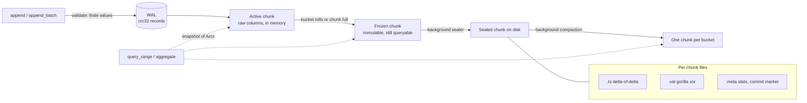

# columnar-tsdb

[](https://github.com/monaaoua9/columnar-tsdb/actions/workflows/ci.yml)


An embedded, zero-dependency time-series storage engine in Rust. Gorilla-style
compression, immutable columnar chunks, a write-ahead log, a time-bucket index
that answers aggregates from chunk metadata, and a background thread that seals
and compacts chunks while reads and writes keep going.

```rust
use columnar_tsdb::{Config, Engine, SeriesKey};

let engine = Engine::open(Config::new("./data"))?;
let cpu = SeriesKey::new("cpu_usage").label("host", "web-1");

engine.append(&cpu, 1_700_000_000_000, 41.5)?;
let pts = engine.query_range(&cpu, 1_700_000_000_000, 1_700_003_600_000)?; // [start, end)
let agg = engine.aggregate(&cpu, i64::MIN, i64::MAX)?;                      // count/sum/min/max/avg
```

## Data flow



A point is durable (in the OS sense, see `SyncMode`) once `append` returns. It
sits in an active chunk until its time bucket changes or the chunk reaches
`max_points_per_chunk`; then the chunk is frozen (swapped for a fresh one under
the series lock, no IO) and the maintenance thread encodes it into three files.
A checkpoint (`flush`, close, or WAL over `wal_max_bytes`) truncates the WAL
once every in-memory chunk is sealed.

## Layout

```
src/
  bitio.rs            msb-first BitWriter / BitReader
  compress/
    timestamp.rs      delta-of-delta codec
    gorilla.rs        xor float codec
  chunk.rs            ActiveChunk, SealedChunk, file framing, recovery scan
  series.rs           per-series state: active / frozen / sealed + snapshots
  wal.rs, catalog.rs  write-ahead log, series catalog (both crc'd, torn-tail safe)
  engine.rs           public API, background worker, flush, compaction, retention
tests/engine.rs       end-to-end: crash recovery, compaction, concurrency
examples/ingest_bench.rs
```

On disk:

```
data/
  LOCK  series.cat  wal.log
  chunks/
    {series:016x}-{id:010}.ts     timestamps, own file
    {series:016x}-{id:010}.val    values, own file
    {series:016x}-{id:010}.meta   count/min/max/sum/min_ts/max_ts, written last
```

Labels live in the series catalog (dictionary encoded: one id per label set),
not repeated per point.

## Compression

- **Timestamps**: delta-of-delta with 1/9/12/16-bit prefix buckets and a 68-bit
  escape. A fixed scrape interval costs one bit per point.
- **Values**: XOR with the previous value; reuse the previous leading/trailing
  zero window when it fits, otherwise emit a new 5+6 bit window header.
- Both are exact for any `i64` / finite `f64` sequence (tested against random
  and adversarial inputs). Values are rejected if NaN or infinite.

## Query path

`aggregate(start, end)` finds candidate buckets with a `BTreeMap` range lookup
(`O(log B)`; the bucket of a timestamp itself is `O(1)` arithmetic). Chunks whose
`[min_ts, max_ts]` lies fully inside the range contribute their stored
`count/sum/min/max` and are never read from disk. Only chunks straddling the
range edges are decoded. `query_range` decodes the timestamp column first, binary
searches the slice, then decodes values only up to the end of the slice.

## Concurrency model

- One `RwLock` per series; writers to different series don't contend except for
  the WAL mutex.
- Queries copy a few `Arc`s and filtered in-memory points under a read lock, then
  decode with no lock held. Sealed chunks are immutable.
- Freeze -> seal is a single write-lock swap, so a reader sees every point exactly
  once (checked by the concurrency test: readers assert gap-free prefixes while
  sealing and compaction run).
- Compaction writes the merged chunk first, then swaps it in; old files are
  deleted when the last `Arc` to them drops, so running queries never lose files.
- Lock order: `maintenance -> catalog -> series -> wal`. Writers hold at most one
  series lock, the checkpoint takes series locks in id order.

## Out-of-order writes

Any timestamp order is accepted, including inside one batch.

- A point with `ts > newest ts of the series` takes the fast path (active chunk).
- Anything else is a *late write*: it goes into a small sorted buffer per series
  and is visible to queries immediately. Same `ts` again means **last write wins**,
  also over a value that is already sealed on disk.
- The maintenance thread folds the buffer into the sealed chunk(s) of the point's
  bucket: decode, merge with override, write one new chunk, swap it in under the
  series lock, delete the old files when the last reader lets go. Points at or above
  the oldest raw in-memory chunk wait until that chunk is sealed, so sealed chunks
  never overlap unsealed data.
- A chunk with a late point inside its `[min_ts, max_ts]` is not answered from
  stats; it is decoded and merged. Everything else keeps the stats-only path.
- WAL records carry a `late` flag. Replay skips in-order records that are already
  sealed, but re-applies every late record: that is idempotent and the log replays
  in write order, so the final value per `ts` is the same as before the crash.
- With `retention` set, a late point older than `newest - retention` is rejected
  with `Error::TooOld` instead of being stored and expired right away.

The price is write amplification: merging one late point rewrites its bucket.
Batching in the buffer (`max_ooo_points`, maintenance interval) is what keeps that
tolerable. Correctness is checked by a randomized test that mixes in-order, late
and duplicate writes with flushes, compactions and crash-style reopens against a
`BTreeMap` model.

## Recovery

On open: catalog and chunk metas are loaded, orphan/tmp files removed, chunks
fully contained in a larger chunk of the same series (crash during compaction)
are dropped, then the WAL is replayed (in-order records newer than the last sealed ts, plus all late records).
Torn WAL/catalog tails are cut at the first bad checksum.

## Numbers

`cargo run --release --example ingest_bench` (8 series x 500k points, 10 s
interval, 1-day buckets, noisy 2-decimal gauge, laptop, Windows 11). The ingest
figure is sustained: writers are throttled by the sealer (`max_frozen_chunks`), so
it includes the cost of writing the chunk files, not just the in-memory append.

```
ingest: 4000000 points in 1.03s = 3.87 M pts/s
stored: 472 chunks, 6.14 bytes/point (2.6x vs 16 B raw)   # noise-dominated; smooth data is far smaller
full-range aggregate (stats only): 24 us
1h window aggregate (partial chunk decode): 1.3 ms
full scan: 500000 points in 129 ms
```

With 2-hour buckets (5.5k tiny chunks, 3 files each) the same run takes about a
minute on Windows because file creation dominates; that is the cost of the
file-per-column layout with small chunks.

`cargo bench` (criterion, 100k points, same machine):

| | throughput |
|---|---|
| timestamp encode / decode | ~41 / ~45 M pts/s |
| gorilla encode / decode | ~9.6 / ~12.3 M pts/s |
| engine `append_batch` (WAL + active chunk) | ~2.4 M pts/s |

Backpressure: appends to a series block once it has more than
`max_frozen_chunks` waiting for the sealer, and fail if the sealer is erroring.

## Limits (deliberate)

- Late writes cost a bucket rewrite when merged (see above).
- The block cache evicts FIFO, not LRU.
- WAL records are 29 bytes uncompressed; the WAL is one file for all series.
- Sum is a plain f64 accumulation.
- No fsync of the chunk directory after renames.

## Development

```
cargo fmt --all
cargo clippy --all-targets -- -D warnings
cargo test
```

MSRV 1.89 (uses `File::try_lock`). MIT licensed, (c) 2026 Amenah Saleh.
