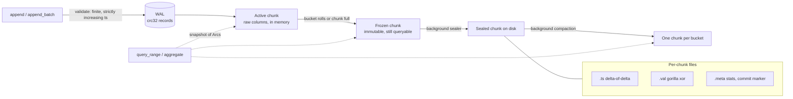

# columnar-tsdb

[](https://github.com/monaaoua9/columnar-tsdb/actions/workflows/ci.yml)


An embedded, zero-dependency time-series storage engine in Rust. Gorilla-style
compression, immutable columnar chunks, a write-ahead log, a time-bucket index
that answers aggregates from chunk metadata, and a background thread that seals
and compacts chunks while reads and writes keep going.

```rust
use columnar_tsdb::{Config, Engine, SeriesKey};

let engine = Engine::open(Config::new("./data"))?;
let cpu = SeriesKey::new("cpu_usage").label("host", "web-1");

engine.append(&cpu, 1_700_000_000_000, 41.5)?;
let pts = engine.query_range(&cpu, 1_700_000_000_000, 1_700_003_600_000)?; // [start, end)
let agg = engine.aggregate(&cpu, i64::MIN, i64::MAX)?;                      // count/sum/min/max/avg
```

## Data flow



A point is durable (in the OS sense, see `SyncMode`) once `append` returns. It
sits in an active chunk until its time bucket changes or the chunk reaches
`max_points_per_chunk`; then the chunk is frozen (swapped for a fresh one under
the series lock, no IO) and the maintenance thread encodes it into three files.
A checkpoint (`flush`, close, or WAL over `wal_max_bytes`) truncates the WAL
once every in-memory chunk is sealed.

## Layout

```
src/
  bitio.rs            msb-first BitWriter / BitReader
  compress/
    timestamp.rs      delta-of-delta codec
    gorilla.rs        xor float codec
  chunk.rs            ActiveChunk, SealedChunk, file framing, recovery scan
  series.rs           per-series state: active / frozen / sealed + snapshots
  wal.rs, catalog.rs  write-ahead log, series catalog (both crc'd, torn-tail safe)
  engine.rs           public API, background worker, flush, compaction, retention
tests/engine.rs       end-to-end: crash recovery, compaction, concurrency
examples/ingest_bench.rs
```

On disk:

```
data/
  LOCK  series.cat  wal.log
  chunks/
    {series:016x}-{id:010}.ts     timestamps, own file
    {series:016x}-{id:010}.val    values, own file
    {series:016x}-{id:010}.meta   count/min/max/sum/min_ts/max_ts, written last
```

Labels live in the series catalog (dictionary encoded: one id per label set),
not repeated per point.

## Compression

- **Timestamps**: delta-of-delta with 1/9/12/16-bit prefix buckets and a 68-bit
  escape. A fixed scrape interval costs one bit per point.
- **Values**: XOR with the previous value; reuse the previous leading/trailing
  zero window when it fits, otherwise emit a new 5+6 bit window header.
- Both are exact for any `i64` / finite `f64` sequence (tested against random
  and adversarial inputs). Values are rejected if NaN or infinite.

## Query path

`aggregate(start, end)` finds candidate buckets with a `BTreeMap` range lookup
(`O(log B)`; the bucket of a timestamp itself is `O(1)` arithmetic). Chunks whose
`[min_ts, max_ts]` lies fully inside the range contribute their stored
`count/sum/min/max` and are never read from disk. Only chunks straddling the
range edges are decoded. `query_range` decodes the timestamp column first, binary
searches the slice, then decodes values only up to the end of the slice.

## Concurrency model

- One `RwLock` per series; writers to different series don't contend except for
  the WAL mutex.
- Queries copy a few `Arc`s and filtered in-memory points under a read lock, then
  decode with no lock held. Sealed chunks are immutable.
- Freeze -> seal is a single write-lock swap, so a reader sees every point exactly
  once (checked by the concurrency test: readers assert gap-free prefixes while
  sealing and compaction run).
- Compaction writes the merged chunk first, then swaps it in; old files are
  deleted when the last `Arc` to them drops, so running queries never lose files.
- Lock order: `maintenance -> catalog -> series -> wal`. Writers hold at most one
  series lock, the checkpoint takes series locks in id order.

## Recovery

On open: catalog and chunk metas are loaded, orphan/tmp files removed, chunks
fully contained in a larger chunk of the same series (crash during compaction)
are dropped, then the WAL is replayed for points newer than the last sealed ts.
Torn WAL/catalog tails are cut at the first bad checksum.

## Numbers

`cargo run --release --example ingest_bench` (8 series x 500k points, 10 s
interval, noisy 2-decimal gauge, laptop, Windows 11):

```
ingest: 4000000 points in 1.53s = 2.62 M pts/s
stored: 5.95 bytes/point (2.7x vs 16 B raw)       # noise-dominated; smooth data is far smaller
full-range aggregate (stats only): 56 us
1h window aggregate (partial chunk decode): 87 us
full scan: 500000 points in 83 ms
```

`cargo bench` (criterion, 100k points, same machine):

| | throughput |
|---|---|
| timestamp encode / decode | ~41 / ~45 M pts/s |
| gorilla encode / decode | ~9.6 / ~12.3 M pts/s |
| engine `append_batch` (WAL + active chunk) | ~2.4 M pts/s |

Backpressure: appends to a series block once it has more than
`max_frozen_chunks` waiting for the sealer, and fail if the sealer is erroring.

## Limits (deliberate)

- Strictly increasing timestamps per series; out-of-order writes are rejected.
- The block cache evicts FIFO, not LRU.
- WAL records are 28 bytes uncompressed; the WAL is one file for all series.
- Sum is a plain f64 accumulation.
- No fsync of the chunk directory after renames.

## Development

```
cargo fmt --all
cargo clippy --all-targets -- -D warnings
cargo test
```

MSRV 1.89 (uses `File::try_lock`). MIT licensed, (c) 2026 Amenah Saleh.
